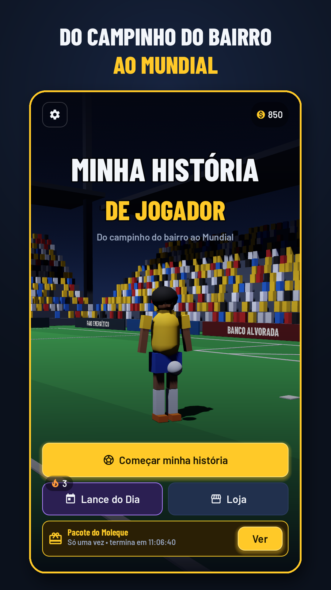
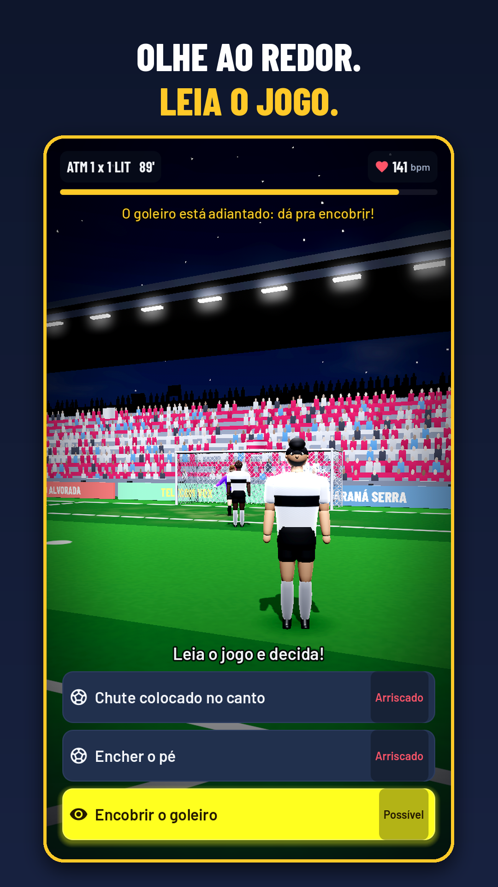
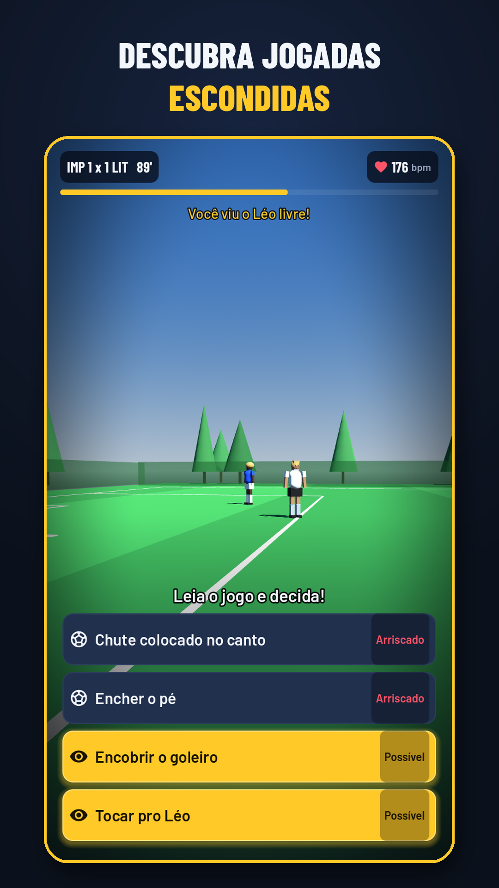
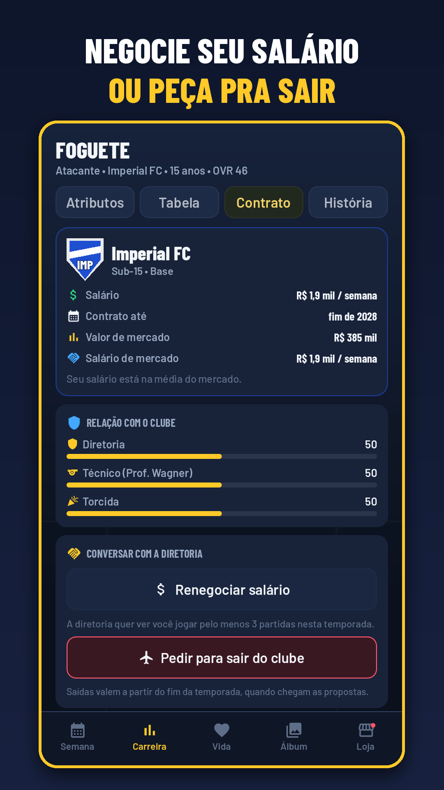
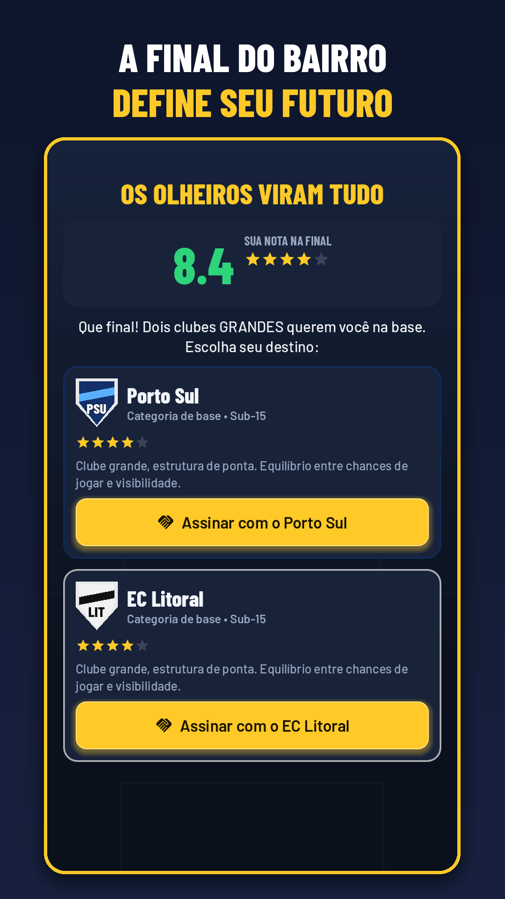
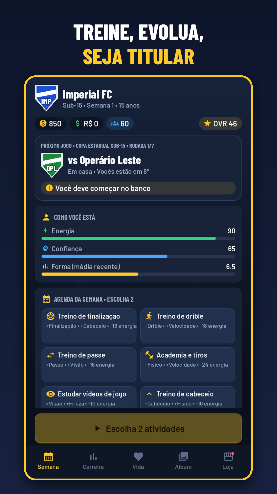
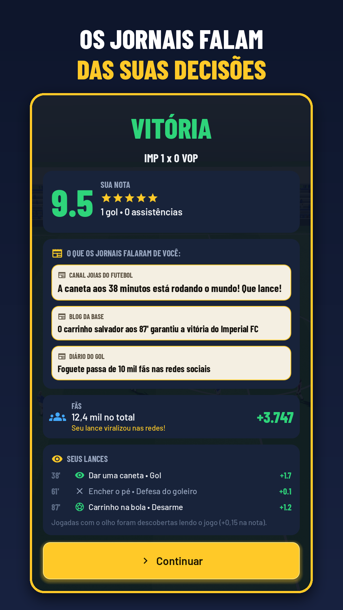
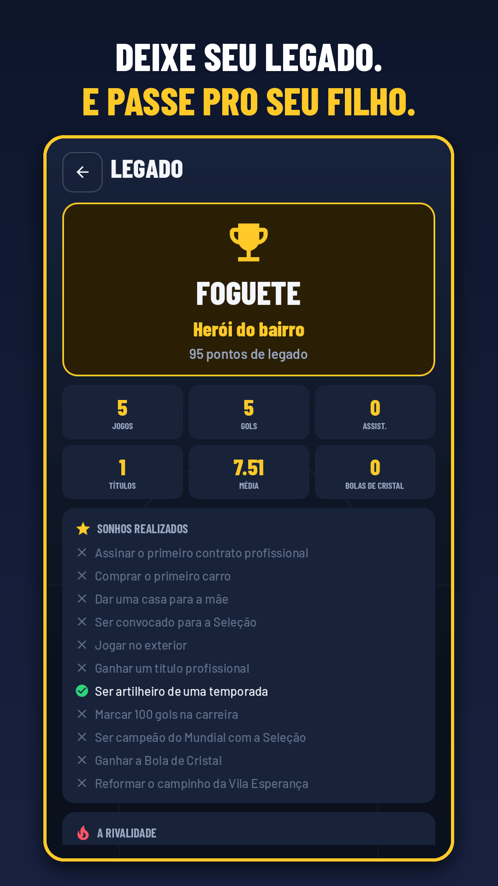

# Minha História de Jogador ⚽

**Do campinho do bairro ao Mundial.** Jogo de carreira de futebol para Android em que você não aperta botões para correr: você **lê o jogo**. Olhe ao redor, encontre o companheiro livre, perceba o goleiro adiantado, escolha a jogada e assista ao lance **pelos olhos do seu jogador**.

| | | | |
|---|---|---|---|
|  |  |  |  |
|  |  |  |  |

## O que tem no jogo
- **Prólogo:** a final da Copa da Vila, no campo de terra. Sua nota define o clube de base (grande, médio ou peneira).
- **Momentos decisivos em 1ª pessoa:** 13 situações procedurais (tabela, escanteio com bicicleta, rebote, voleio...), com anti-repetição para nenhum jogo ser igual ao outro. **Olhar ao redor revela jogadas escondidas** (caneta, cobertura, lançamento, a leitura do goleiro no pênalti), com coração acelerado, visão em túnel e instinto.
- **"E se...?":** errou o lance? Reviva-o sabendo o que vai acontecer.
- **Comemorações** com efeito na carreira e **chuteiras** que você vê nos próprios pés.
- **Atacante que marca:** no fim do jogo você volta para defender (carrinho, bote, antecipar o passe, afastar o cruzamento) e segura a vitória.
- **"O que os jornais falaram de você":** manchetes depois de cada partida sobre as suas decisões, e **fãs** que crescem com bons jogos e clubes maiores.
- **Contrato de verdade:** renegocie o salário (com palpite do empresário e contraproposta) ou peça para sair do clube, e até force a saída se a diretoria não liberar.
- **Carreira completa:** Sub-15, Sub-17, Sub-20, profissional, 9 países fictícios, Seleção (Mundial), Bola de Cristal e aposentadoria.
- **Vida fora de campo:** 33 eventos narrativos, relações (incluindo a diretoria), empresário, imprensa, rival e sonhos (a casa da mãe, reformar o campinho).
- **Retenção:** objetivos de temporada, álbum de memórias, Lance do Dia com sequência, Hall da Fama e **Nova Geração** (jogue com o filho da sua lenda).
- **Monetização ética:** anúncios recompensados opcionais e diegéticos, intersticial com limites rígidos, VIP, remover anúncios, pacote inicial e moedas para cosméticos. Dinheiro não compra nota em campo.

## Tecnologia
Godot 4.5.1 • 3D 100% procedural com shaders próprios (gramado, céu, torcida animada, rede, bola) • áudio sintetizado • retrato • AdMob, Google Play Billing e Firebase com adaptadores e modo simulado • bateria de testes automatizados (mais de 35 mil verificações).

## Documentação
- [Documento de Design (GDD)](docs/GDD.md)
- [Guia de publicação na Google Play](docs/PUBLICACAO.md) (AdMob, produtos, Firebase, AAB, ficha da loja)
- [Projeto Godot: como abrir, testar e exportar](jogo/README.md)
- [Política de privacidade](docs/privacidade.html)

*Todos os clubes, ligas, marcas e jogadores são fictícios.*
