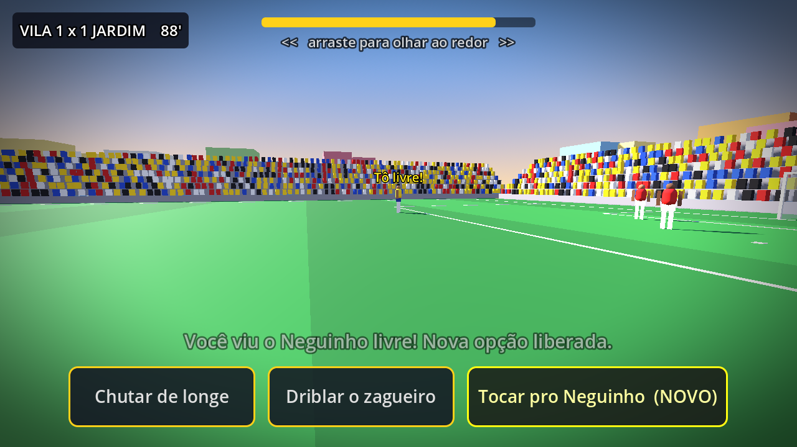
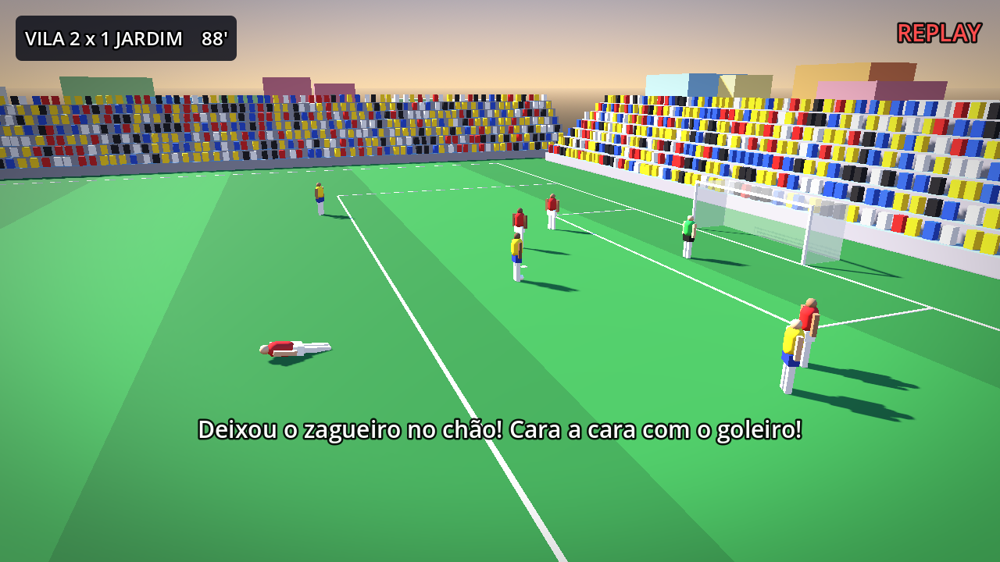
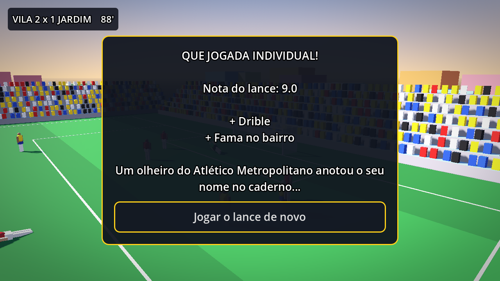

# Minha História de Jogador ⚽

Jogo para Android de **carreira de jogador de futebol**. A história começa na final do campeonato do bairro e, dependendo do seu desempenho, você vai para a base de um clube grande ou de um clube médio.

A mecânica central é **"Escolha e Veja"**: nos momentos decisivos da partida, você olha ao redor, escolhe a jogada e assiste ao lance **em primeira pessoa**, pelos olhos do jogador.

| Olhar revela opções | Replay da TV | Nota do lance |
|---|---|---|
|  |  |  |

- **Engine:** Godot 4.5, 3D low-poly
- **Plataforma:** Android (Google Play)
- **Modelo:** gratuito, com anúncios e compras no app
- **Status:** protótipo jogável de um lance ([`jogo/`](jogo/README.md))

## Documentação
- [Documento de Design (GDD)](docs/GDD.md)
- [Como abrir e testar o protótipo](jogo/README.md)
